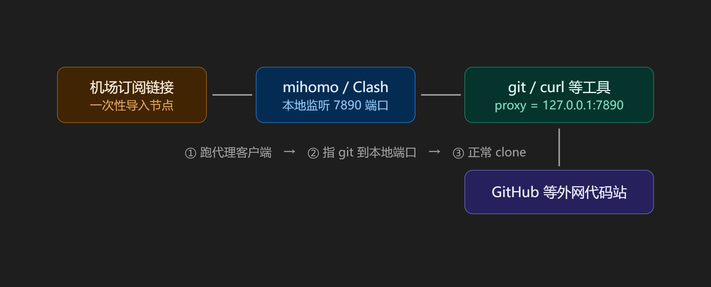
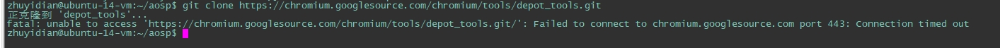
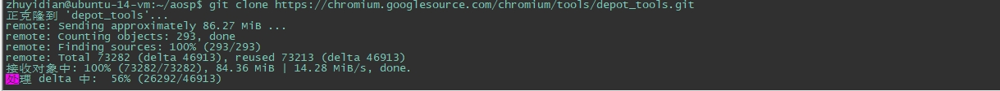

# 一、核心思路

核心思路一句话：订阅链接 → 在服务器上跑一个代理客户端（Clash/mihomo）→ 得到本地代理端口（如 127.0.0.1:7890）→ 让 git 走这个端口。git 本身不认订阅链接，必须由客户端把订阅链接"翻译"成本地 HTTP/SOCKS5 代理。



下面是完整操作步骤（在 Ubuntu 20 服务器上执行）

# 二、操作步骤

## 1、第一步：部署代理客户端（以 mihomo 为例，即原 Clash 内核）

```markdown
mkdir -p ~/mihomo && cd ~/mihomo

# 当前最新版是 v1.19.33，你的 Ubuntu 20 服务器（x86_64）应该用这个链接：
wget https://github.com/MetaCubeX/mihomo/releases/download/v1.19.33/mihomo-linux-amd64-compatible-v1.19.33.gz
gunzip mihomo-linux-amd64-compatible-v1.19.33.gz
mv mihomo-linux-amd64-compatible-v1.19.33 mihomo && chmod +x mihomo

# 以后想自动拿最新版，可以用这两行拼出链接（避免版本号过期）：
ver=$(curl -s https://api.github.com/repos/MetaCubeX/mihomo/releases/latest | grep -oP '"tag_name":\s*"\K[^"]+')
wget "https://github.com/MetaCubeX/mihomo/releases/download/${ver}/mihomo-linux-amd64-compatible-${ver}.gz"

# 后台启动
nohup ./mihomo-linux-amd64-compatible -d ~/mihomo > ~/mihomo/run.log 2>&1 &
```

## 2、第二步：创建 config.yaml

在 `~/mihomo` 目录下创建 `config.yaml`，内容如下（参数全部来自梯子订阅的 vless 链接）：

示例中的 `YOUR_...` 为占位符，使用前请按自己的订阅填写节点参数，其中端口需填写数字。

```yaml
mixed-port: 7890
allow-lan: false
bind-address: 127.0.0.1
mode: rule
log-level: info

proxies:
  - name: "grpc-reality"
    type: vless
    server: YOUR_SERVER_ADDRESS
    port: YOUR_SERVER_PORT
    uuid: YOUR_VLESS_UUID
    udp: true
    tls: true
    network: grpc
    servername: YOUR_TLS_SERVER_NAME
    client-fingerprint: chrome
    reality-opts:
      public-key: "YOUR_REALITY_PUBLIC_KEY"
      short-id: "YOUR_REALITY_SHORT_ID"
    grpc-opts:
      grpc-service-name: GunService

proxy-groups:
  - name: PROXY
    type: select
    proxies:
      - grpc-reality

rules:
  - MATCH,PROXY
```

参数对应关系：`sni` → `servername`，`pbk` → `public-key`，`sid` → `short-id`，`fp` → `client-fingerprint`。链接里 `serviceName=` 是空的，按照 Xray 惯例空值等价于默认的 `GunService`，所以我显式填上了；如果连接失败，先尝试把 `grpc-opts` 这两行删掉（让 mihomo 用默认值）。

## 3、第三步：启动并验证

```markdown
cd ~/mihomo
nohup ./mihomo -d ~/mihomo > run.log 2>&1 &

# 看日志有没有报错
tail -f run.log

# 验证代理是否通了（另开一个终端）
curl -x http://127.0.0.1:7890 https://api.ip.sb

# 如果返回的 IP 不是服务器的 IP，说明代理已生效。
```

## 4、第四步：让git走代理

```
# 方式一：只对 github.com 生效（推荐，不影响内网仓库）
git config --global http.https://github.com.proxy http://127.0.0.1:7890

# 方式二：全局 https 代理
git config --global http.proxy http://127.0.0.1:7890
git config --global https.proxy http://127.0.0.1:7890
```

## 5、第五步：去git clone吧

```
git clone https://chromium.googlesource.com/chromium/tools/depot_tools.git
```

# 三、停止代理

```
pkill -f mihomo
```

# 四、验证

未开启代理：



开启代理：



# 五、注意

`config.yaml`中的内容是根据已有的订阅链接生成的，如果换了订阅链接，那么需要重新覆盖`config.yaml`内容，并重新启动代理
